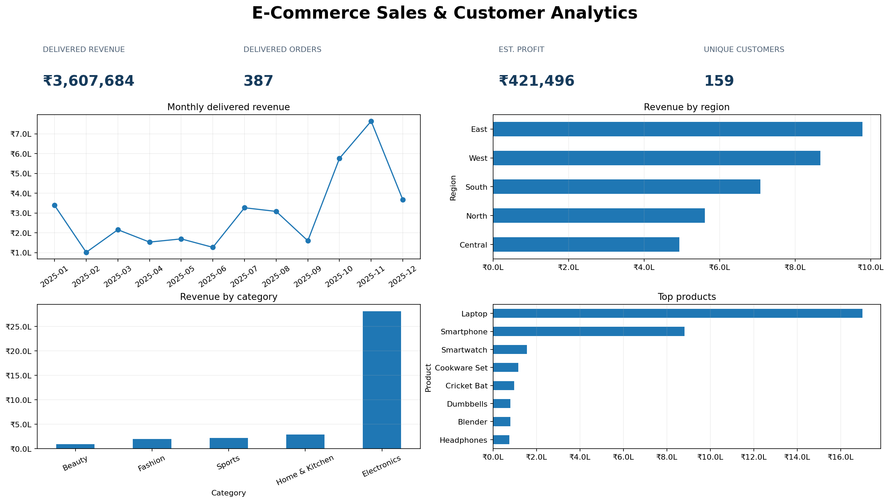
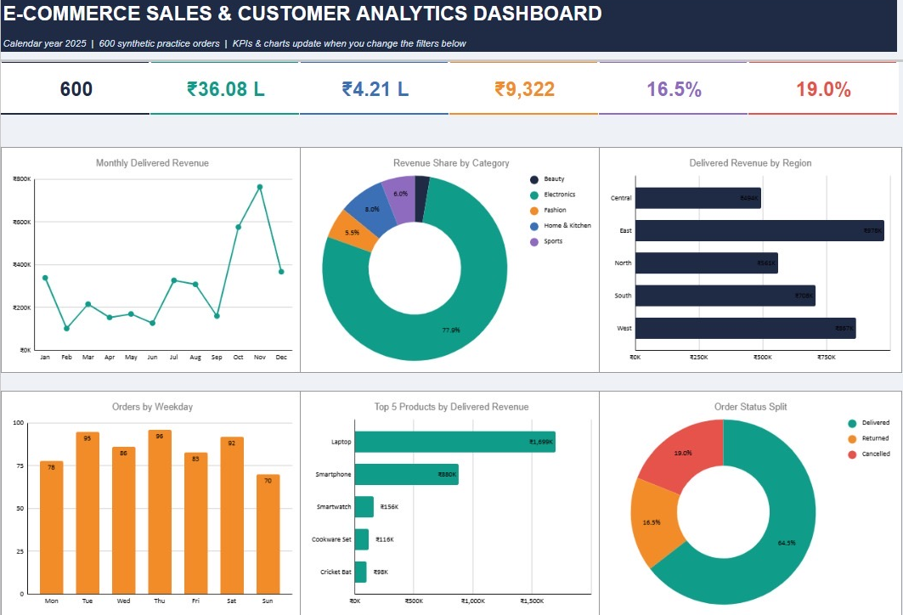
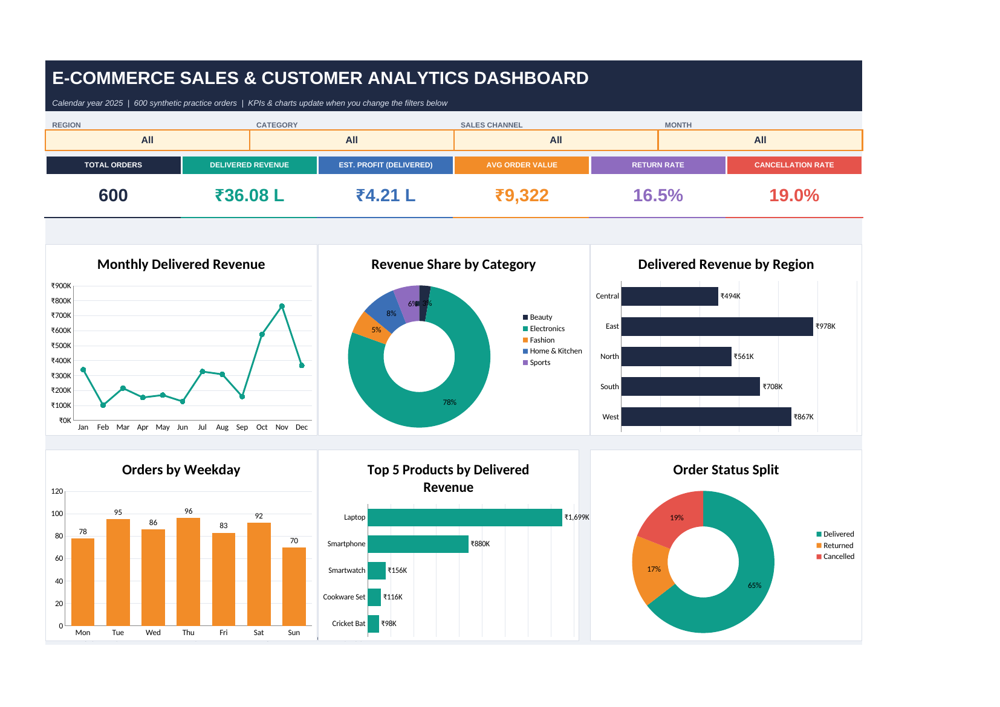
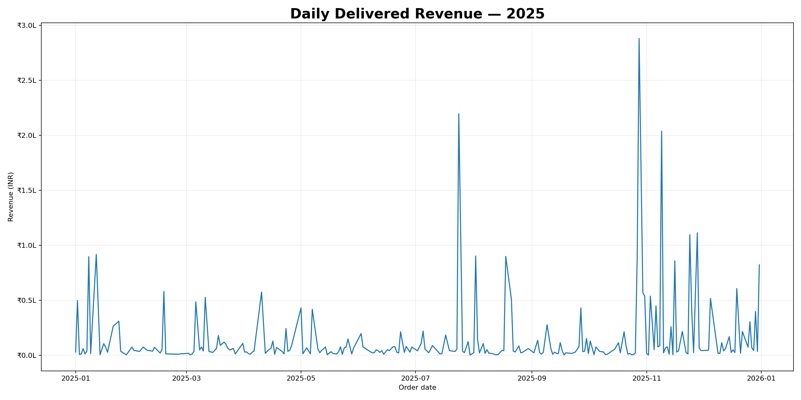
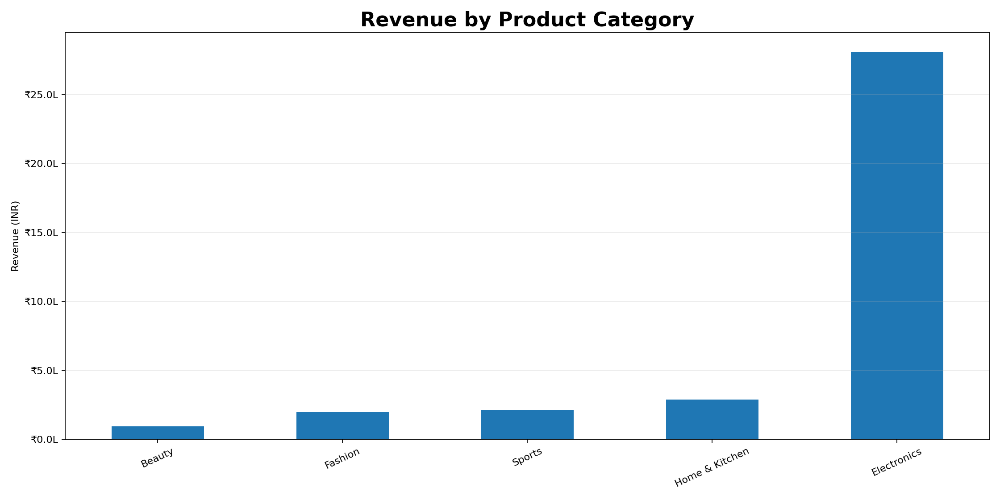
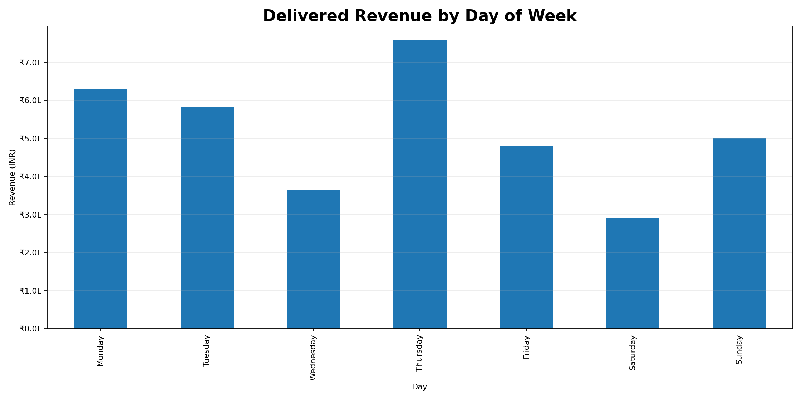

# E-Commerce Sales & Customer Analytics

**End-to-end Data Analytics portfolio project** | Excel · SQL · Python · Power BI (DAX guide) · Interactive HTML · Jupyter

A practical analytics workflow exploring sales performance, customers, products, categories, regions, channels and order status. The repository includes the source dataset, reproducible Python analysis, SQL query packs, interactive dashboards, charts, report and setup documentation.

> **Data transparency:** This project uses 600 synthetic practice orders dated in 2025. It is not real company or customer data. `Profit_INR` and profit KPIs are estimates based on assumed product margins, not audited company profit.

## Project dashboard previews

### 1. Project overview


### 2. Excel dashboard — view it here on GitHub
The PNG below is a direct preview of the Excel dashboard. You can view it on GitHub without downloading or opening the workbook.



**Download the complete Excel workbook:** [`excel/Ecommerce_Sales_Analytics_Dashboard.xlsx`](excel/Ecommerce_Sales_Analytics_Dashboard.xlsx)

The workbook contains 13 worksheets, including the interactive `Dashboard`, `Executive_Dashboard`, `Charts`, the full `Sales_Data` source table (600 orders), category/region/channel analyses, top products/customers, order status, monthly trends, recommendations and a read-me sheet. The dashboard includes six dropdown filters and five charts. The PNG is only the quick visual preview; the XLSX retains the dashboard and supporting data/analysis sheets.

### 3. Interactive web dashboard


Open [`index.html`](index.html) in Chrome or Edge. It includes six filters, KPI cards, charts and a detail table; no external API is required.

### 4. Daily delivered revenue trend


### 5. Category performance


### 6. Regional performance


### 7. Top products


### 8. Weekday analysis


## Verified dataset KPIs

| Metric | Value |
|---|---:|
| Total orders | 600 |
| Delivered orders | 387 |
| Returned orders | 99 |
| Cancelled orders | 114 |
| Delivered revenue | ₹36,07,684.18 |
| Estimated delivered profit | ₹4,21,495.53 |
| Unique customers (all orders) | 175 |
| Average delivered order value | ₹9,322.18 |

Metrics are calculated from the included CSV; estimated profit is an assumption-based measure.

## What this project demonstrates

- Data validation, cleaning and exploratory analysis
- KPI definition and sales/customer performance analysis
- SQL filtering, aggregation, CTEs, subqueries and window functions
- Python analysis with pandas, NumPy and Matplotlib
- Excel dashboard design and filter-driven analysis
- Interactive HTML dashboard with client-side filters and charts
- DAX measure definitions and Power BI report build documentation
- Reproducible checks and clear documentation of data limitations

## Repository contents

```text
.
├── .github/workflows/validate.yml
├── data/sales_data.csv
├── docs/
├── excel/Ecommerce_Sales_Analytics_Dashboard.xlsx
├── images/                         # Eight ordered image assets (no screenshot-named folder)
├── notebooks/
├── outputs/
├── power_bi/
├── python/
├── sql/
├── tests/
├── index.html                      # Interactive dashboard entry point
├── Interactive_Dashboard.html
├── Dashboard_Report.pdf
├── requirements.txt
├── LICENSE
└── README.md
```

## Run the project

### Python (Windows / macOS / Linux)

```bash
python -m venv .venv
# Activate the environment, then:
python -m pip install --upgrade pip
pip install -r requirements.txt
python python/ecommerce_analysis.py
```

### SQLite validation

```bash
python tests/run_sqlite_validation.py
```

### PostgreSQL

Import `data/sales_data.csv` into a table named `sales_data`, then run [`sql/ecommerce_sales_analysis.sql`](sql/ecommerce_sales_analysis.sql). The SQL script is provided for PostgreSQL; it has not been represented as executed against a live PostgreSQL server.

### Power BI Desktop

Import the CSV, create the measures in [`power_bi/DAX_Measures.txt`](power_bi/DAX_Measures.txt), and follow [`power_bi/Dashboard_Guide.md`](power_bi/Dashboard_Guide.md). Save your finished report as a `.pbix` file. **A native `.pbix` is not included**; it must be created and saved in Power BI Desktop.

For detailed steps, see [`docs/SETUP_GUIDE.md`](docs/SETUP_GUIDE.md).

## Validation status

Run:

```bash
python tests/validate_project.py
python tests/run_sqlite_validation.py
```

The package checks cover the dataset, dashboard structure/data, workbook structure, notebook, required deliverables and README image links. The SQLite companion queries execute against the included data. Browser interaction and final appearance should still be checked in your own Chrome/Edge and Excel Desktop versions. PostgreSQL execution and native Power BI PBIX creation remain user-side steps.

## License

Code and documentation are released under the MIT License. The synthetic dataset is included for practice and demonstration.
