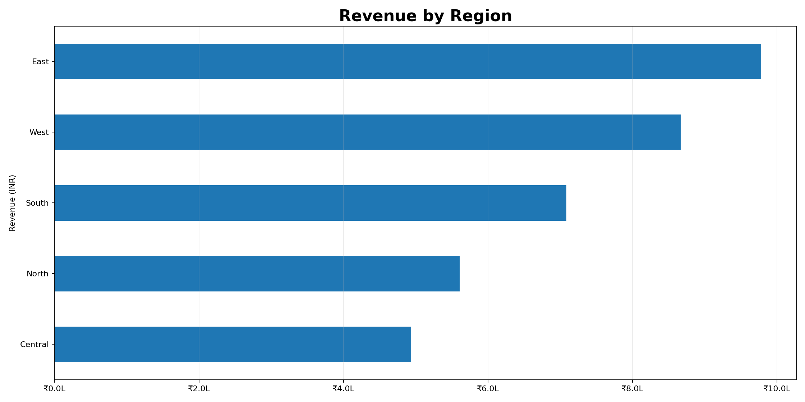
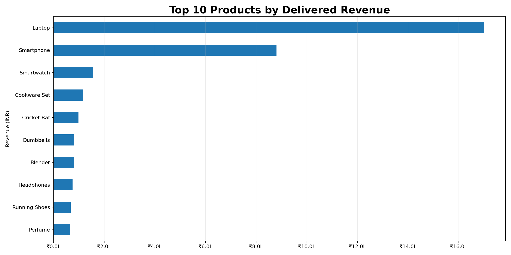

# E-Commerce Sales & Customer Analytics

End-to-end Data Analyst portfolio project using Excel, SQL, Python, Jupyter Notebook, and Power BI resources.


## Dashboard Preview

**Start here:** Open the [Interactive Dashboard](Interactive_Dashboard.html) to use the filters. The dashboard supports Region, Category, Sales Channel, Order Status, Month, and Day of Week; the daily and weekday charts update with the selected filters.

### Executive dashboard


### Daily sales trend


### Monday–Sunday sales comparison


### Category performance


### Regional performance


### Top 10 products



## Dataset and limitations
This repository uses **synthetic practice data (600 orders, 2025)**. It is not real company/customer data. `Profit_INR` is estimated using assumed margins, not audited profit.

## Tools demonstrated
- Excel: prepared KPI dashboard, charts, supporting analysis sheets.
- Python: pandas, NumPy, data validation, aggregation, exploratory analysis, Matplotlib charts.
- SQL: KPI queries, filtering, aggregation, CTE, subquery, window functions, data-quality checks.
- Power BI: prepared DAX measures and report build guide.
- Business analysis: regional, product, channel, monthly and customer analysis.

## Repository map
- `data/`: source CSV
- `excel/`: prepared Excel dashboard
- `python/`: runnable analysis script
- `sql/`: PostgreSQL-compatible SQL queries
- `notebooks/`: Jupyter notebook
- `power_bi/`: DAX and dashboard guide
- `outputs/`: pre-generated CSV summaries, charts and executive report
- `docs/`: data dictionary

## Run Python
From the repository root:
```bash
python -m pip install -r requirements.txt
python python/ecommerce_analysis.py
```
The analysis outputs are already included in `outputs/`; running the script regenerates them.

## Run SQL
Import `data/sales_data.csv` into PostgreSQL as `sales_data`, then execute `sql/ecommerce_sales_analysis.sql`. The file contains table definition guidance and 10 ready-made queries.

## Power BI
Import the CSV in Power BI Desktop, create measures from `power_bi/DAX_Measures.txt`, follow `power_bi/Dashboard_Guide.md`, then save the report as a `.pbix` file. A native PBIX is not included.

## Before publishing
Review the outputs and make sure you can explain the analysis. Do not present synthetic data or estimated profit as real company results.


## Included visual deliverables
- `excel/Ecommerce_Sales_Analytics_Dashboard.xlsx`: prepared Excel dashboard and analysis tabs.
- `Interactive_Dashboard.html`: standalone interactive browser dashboard with daily revenue trend and day-of-week filter.
- `screenshots/`: PNG visuals plus a LinkedIn post draft.
- `outputs/*.png`: Python-generated charts.
- `docs/Dashboard_Report.pdf`: static dashboard report.

## Completion status
Python analysis has been executed to generate the included CSV summaries, charts, and report. SQL queries are prepared but must be executed in a PostgreSQL database. Power BI DAX and build instructions are included, but a native `.pbix` report must be saved from Power BI Desktop.

## Quality checks
See [`docs/QA_Checklist.md`](docs/QA_Checklist.md) for the checks performed and the project limitations.

## Run the project validation checks
From the repository root:
```bash
python -m pip install -r requirements.txt
python tests/validate_project.py
```
The validation script checks the CSV structure and IDs, embedded dashboard data, required dashboard controls/charts, matching dashboard copies, Python execution, Excel workbook structure/charts, notebook JSON, and README image paths.

## Publish the interactive dashboard with GitHub Pages
1. Open the repository on GitHub and select **Settings**.
2. Open **Pages** under **Code and automation**.
3. Under **Build and deployment**, choose **Deploy from a branch**.
4. Select branch **main** and folder **/(root)**, then save.
5. Wait for the Pages deployment and open the URL GitHub displays. The repository includes a root `index.html` copy of the interactive dashboard, so the Pages homepage can open directly after deployment.

The normal repository landing page still shows the file list and README. To feature the repository on your GitHub profile, pin it from **Customize your pins** on your profile page.

## SQL execution status (expanded)
- `sql/ecommerce_sales_analysis_sqlite.sql` is a SQLite-compatible companion containing the same 10 analysis queries.
- Run `python tests/run_sqlite_validation.py` to load the included CSV into an in-memory SQLite database and execute all 10 queries. This companion has been executed successfully against the included 600-row dataset.
- `sql/ecommerce_sales_analysis.sql` remains the PostgreSQL version. It is not represented as PostgreSQL-tested because a PostgreSQL server/client is not bundled in this environment.

## Notebook execution status
The notebook was executed from a fresh Python kernel during package QA. To reproduce locally, install `requirements.txt` and run all cells in Jupyter.

## Power BI status
The package includes the source CSV, DAX measures, and a build guide. A native `.pbix` file cannot be truthfully supplied without creating and validating it in Power BI Desktop. Follow the guide in `power_bi/` and save the report locally as `.pbix` after checking the measures and visuals.

## Browser validation status
The dashboard has structural/data checks and its embedded 600-row dataset matches the CSV. Browser-based visual interaction still needs a final check in your own Chrome/Edge installation; use the six filters and Reset Filters before publishing.
